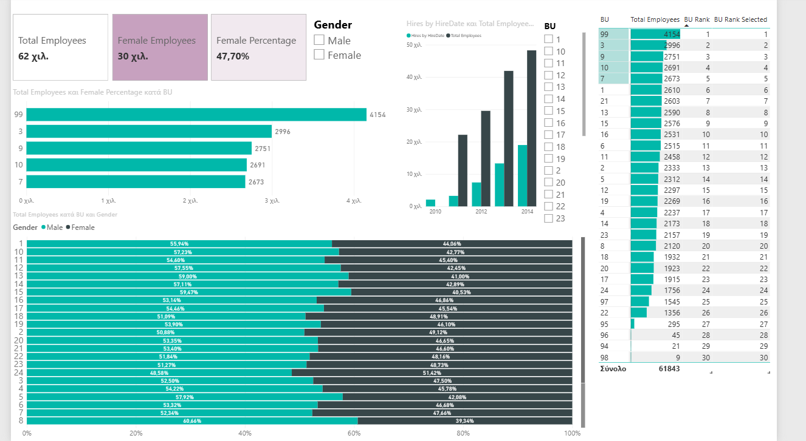

# HR Analytics | Power BI Practice Project

## Dashboard Preview

## Project Overview

This project was developed as part of my hands-on learning and practice in Microsoft Power BI and preparation for the PL-300 certification exam.

I used Microsoft's **Human Resources Sample PBIX** as a starting point and extended it with my own report page, DAX measures, interactive visualizations, and advanced Power BI features.

The purpose of this project is to demonstrate practical skills in data analysis, data modeling, DAX, and business intelligence reporting.

## My Contributions

### DAX Measures
- Calculated total employees using `DISTINCTCOUNT`.
- Created measures for female employees and female percentage.
- Implemented Business Unit rankings using `RANKX`, `ALL`, and `ALLSELECTED`.
- Used `CALCULATE`, `DIVIDE`, and `REMOVEFILTERS` to control filter context.
- Practiced `USERELATIONSHIP` to analyze employee records by hire date.

### Interactive Reporting
- Created a custom **HR Analysis** report page.
- Added interactive slicers for Gender and Business Unit.
- Built KPI cards, bar charts, and comparison visualizations.
- Applied conditional formatting to improve data interpretation.
- Implemented drillthrough navigation and custom report page tooltips.

### Data Modeling and Security
- Explored relationships between fact and dimension tables.
- Created an inactive relationship for hire-date analysis.
- Implemented and tested Row-Level Security (RLS) for a specific Business Unit.

### Performance Analysis
- Used Power BI Performance Analyzer to evaluate report visual performance.

## Tools and Technologies

- Microsoft Power BI Desktop
- DAX
- Data Modeling
- Data Visualization
- Row-Level Security (RLS)
- Performance Analyzer

## Dataset and Attribution

This project is based on Microsoft's **Human Resources Sample PBIX**, using sample data provided by obviEnce.

Original sample: [Microsoft Power BI Desktop Samples](https://github.com/microsoft/powerbi-desktop-samples/blob/main/Sample%20Reports/Human%20Resources%20Sample%20PBIX.pbix)

**Data attribution: obviEnce ©**

The original sample was used for educational purposes. My contributions consist of additional DAX calculations, report visualizations, modeling exercises, and security configurations.

## Project Purpose

This is a learning and portfolio project demonstrating my practical development in Power BI and Business Intelligence.
